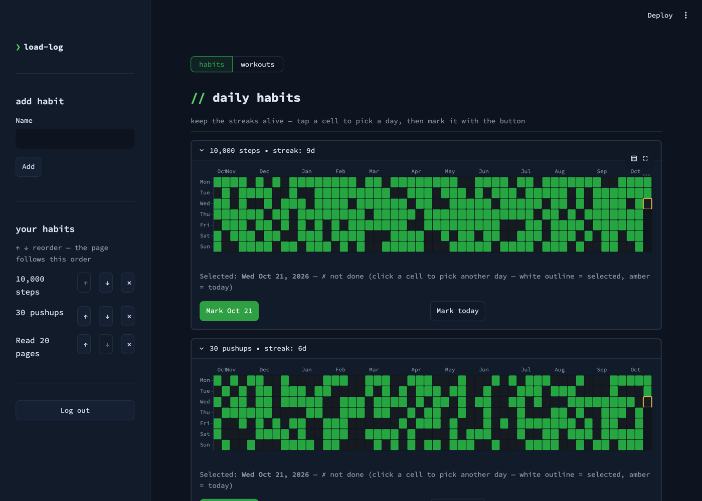
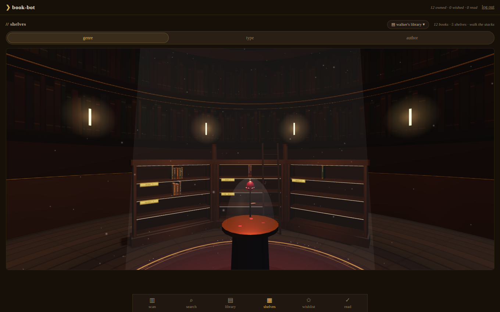

# Hi, I'm Jason (ReadableCode)

I build automation and reusable tools for problems I find interesting. Everything on this account is a personal project. Most of it runs on my homelab: a handful of machines behind a reverse proxy, wired together with Docker, redeployed on push. Comments, forks, and PRs are welcome.

## Where to find me

- [site.tinkernet.me](https://site.tinkernet.me) - my portfolio, served live from the homelab. React frontend, FastAPI backend, and an in-browser terminal. The uptime you see is real.
- [readablecode.github.io](https://readablecode.github.io) - the same site as a static build on GitHub Pages.

The bio also works from a terminal:

```bash
curl https://site.tinkernet.me/api/my-info
```

## Projects

### Apps and services

- **[Sync_Plex](https://github.com/ReadableCode/Sync_Plex)** - A household media system in two halves: a media remote that searches Plex libraries and adds new shows or movies across the network's media servers from a CLI, a Textual TUI, or a phone-friendly web app, and a drive-sync tool that mirrors selected titles onto an external drive for travel. The web UI has its own accounts with roles and an approval queue, so household members request titles and an admin approves them.

- **[load-log](https://github.com/ReadableCode/load-log)** - A health tracker (habits + workouts) with a Textual TUI and a Streamlit web UI over shared storage. Neither UI touches Postgres directly: both go through PostgREST with JWT auth and row-level security, using a per-schema Postgres role. Alembic migrations and two Docker Compose profiles (portable vs. self-contained).

- **[postgrest-auth](https://github.com/ReadableCode/postgrest-auth)** - A small JWT auth service that sits next to PostgREST: `POST /token` checks a bcrypt hash and returns a JWT carrying the Postgres role and user id for RLS. Written once, used by my other apps.

- **[Book-Bot](https://github.com/ReadableCode/Book-Bot)** - An offline eBook organizer. A local LLM (no internet or accounts required) works out author, series, order, and title from messy folders and rebuilds the library into clean nested folders. Can be pointed at hosted APIs instead, with SQLite or Postgres backends.

- **[Terminal To-Do](https://github.com/ReadableCode/Terminal_To_Do)** - A terminal Kanban board driven by Linux-like commands, with pluggable storage (self-hosted MinIO/S3 or Google Sheets).

### Developer tools and libraries

- **[status_board](https://github.com/ReadableCode/status_board)** - A long-running terminal dashboard that shows remote cron job status fetched over SSH (through jump hosts where needed) next to pull requests awaiting my review across several accounts. Panel definitions live in separate config repos, so cloning a context's config repo makes its panels appear, and SSH jump chains are part of the config so it behaves the same on every machine.

- **[readable_utils](https://github.com/ReadableCode/readable_utils)** - A versioned Python utility package that replaced the helper directories I used to copy between repos. Installed from git by tag, with optional dependency extras so each consumer only installs what it needs. herdstone, status_board, and other projects here consume it.

- **[Data Tool Pack](https://github.com/ReadableCode/Data_Tool_Pack_Py)** - Uniform connectors for Snowflake, Databricks, S3, Vault, DuckDB, Google Workspace, and Looker, so analytics work doesn't start with a day of setup. Editions in [Python](https://github.com/ReadableCode/Data_Tool_Pack_Py), [Go](https://github.com/ReadableCode/Data_Tool_Pack_GO), and [Rust](https://github.com/ReadableCode/Data_Tool_Pack_RS).

### Self-hosted infrastructure

- **Self-hosted platform** - The infrastructure everything else runs on: multi-host Docker Compose behind a SWAG reverse proxy with TLS and dynamic DNS. The main server runs Authelia, Vaultwarden, Postgres with PostgREST and pgAdmin, MinIO, Grafana, ntfy, Portainer, Plex, a private registry, and my own apps, each included from its own repo's compose file. An Unraid NAS holds the bulk storage. Pushing to master redeploys whatever changed. The repo stays private since it maps my internal network.

- **[dotfiles](https://github.com/ReadableCode/dotfiles)** - Config sync and provisioning across Linux, Windows, macOS, Android, a router, and a NAS. Pulls configs over SSH/SCP from devices that can't symlink into a repo, provisions with Ansible, and includes a Go `git_puller` cross-compiled for four OS/arch targets.

- **[herdstone](https://github.com/ReadableCode/herdstone)** - A machine-herd monitor. One Python engine with three thin UIs (Typer CLI, Textual TUI, NiceGUI web) that import it in-process, no internal REST layer. It fans out concurrent pings across a host inventory, does OS-aware disk usage checks, pushes SSH keys, and puts `--json` on every command so shells can consume it as a subprocess. The inventory is a single JSON file, so adding a machine is a config edit, not code, and there's an Ansible-inventory importer to bootstrap it.

### Games

- **[Trojan-Force](https://github.com/ReadableCode/Trojan-Force)** - A browser tower-defense game (TypeScript, Phaser 3, Vite): mine resources, build supply chains, survive 20 waves. Custom pathfinding, resource manager, and event bus, plus LAN multi-device play.

- **[Solitaire Associations](https://github.com/ReadableCode/Solitaire_Associations)** - A word-association solitaire game for the browser: word cards deal into tableau columns plus a draw deck, and every card belongs to exactly one of four categories. 150 levels ramp on a single curve that tightens the move budget from about 3.5x a perfect solve down to 1.3x, buries more of the deck face-down, and withdraws hints and jokers as you climb. The game engine is a dependency-free ES module, deterministic given a level and a seed, so the rules are tested under node with no browser involved, including a check that every shipped level is still winnable. Accounts are argon2id over the app's own Postgres schema, reached through PostgREST with row-level security.

- **A 2D game in Unity / C#** - building this one with my wife. Not open source yet.

The portfolio site itself is a project too: React 19 + FastAPI, self-hosted on the same stack.

## Screenshots

Screenshots come from each project's own repo, taken against demo data.

<table>
  <tr>
    <td width="50%" valign="top">
      <a href="https://github.com/ReadableCode/Sync_Plex"><b>Sync_Plex</b></a><br>
      Search Plex libraries and add shows or movies across media servers from a CLI, TUI or web app.<br><br>
      
    </td>
    <td width="50%" valign="top">
      <a href="https://github.com/ReadableCode/herdstone"><b>herdstone</b></a><br>
      Machine-herd monitor: one engine, three UIs, concurrent ping fan-out.<br><br>
      
    </td>
  </tr>
  <tr>
    <td valign="top">
      <a href="https://github.com/ReadableCode/status_board"><b>status_board</b></a><br>
      Terminal dashboard for remote cron jobs over SSH and PRs awaiting review.<br><br>
      
    </td>
    <td valign="top">
      <a href="https://github.com/ReadableCode/load-log"><b>load-log</b></a><br>
      Health tracker with a Textual TUI and a Streamlit web UI over PostgREST.<br><br>
      
    </td>
  </tr>
  <tr>
    <td valign="top">
      <a href="https://github.com/ReadableCode/Book-Bot"><b>Book-Bot</b></a><br>
      Offline eBook organizer: a local LLM sorts messy folders into a clean library.<br><br>
      
    </td>
    <td valign="top">
      <a href="https://github.com/ReadableCode/dotfiles"><b>dotfiles</b></a><br>
      Config sync and provisioning across machines, including a terminal calendar board.<br><br>
      
    </td>
  </tr>
  <tr>
    <td valign="top">
      <a href="https://github.com/ReadableCode/Trojan-Force"><b>Trojan-Force</b></a><br>
      Browser tower-defense game in TypeScript and Phaser 3.<br><br>
      
    </td>
    <td valign="top">
      <a href="https://github.com/ReadableCode/Solitaire_Associations"><b>Solitaire Associations</b></a><br>
      Word-association solitaire with 150 levels.<br><br>
      
    </td>
  </tr>
  <tr>
    <td valign="top">
      <a href="https://github.com/ReadableCode/Terminal_To_Do"><b>Terminal To-Do</b></a><br>
      Terminal Kanban board driven by Linux-like commands.<br><br>
      
    </td>
    <td valign="top">
      Also featured, without a UI to show:
      <a href="https://github.com/ReadableCode/readable_utils">readable_utils</a>,
      <a href="https://github.com/ReadableCode/Data_Tool_Pack_Py">Data Tool Pack</a>,
      <a href="https://github.com/ReadableCode/postgrest-auth">postgrest-auth</a>,
      and the private self-hosted platform the site runs on.
    </td>
  </tr>
</table>

## Skills

| Area | Tools |
|------|-------|
| **Languages** | Python (uv), TypeScript, Go, Rust, SQL, Bash / PowerShell / AutoHotkey, C# |
| **Web / API** | FastAPI, React 19 + Vite, nginx, Streamlit, NiceGUI, Phaser 3 |
| **TUI / CLI** | Textual, Typer, Rich, custom terminal apps |
| **Data** | pandas, DuckDB, warehouse connectors (Snowflake/Databricks/Looker), OCR/PDF |
| **Databases / storage** | PostgreSQL + PostgREST, Alembic + RLS, SQLite, MinIO/S3, Vault |
| **Auth / security** | Authelia SSO, JWT (HS256), bcrypt/argon2, Postgres Row-Level Security |
| **Infra / DevOps** | Docker & multi-host Compose, SWAG + TLS + dynamic DNS, private registry, Grafana + ntfy, Ansible, k3s, Tailscale, WireGuard, push-to-master auto-deploy |
| **Automation / ops** | SSH automation (paramiko, jump hosts), scheduled backups (Postgres dumps, rsync offsite), Home Assistant |
| **Testing / quality** | pytest, mypy, ESLint, GitHub Actions |
| **AI** | Local LLM serving (llama.cpp, CUDA), swappable OpenAI backend, agent-assisted development with Claude Code |

## Contact

Open an issue or PR on any repo, or say hi from the terminal at [site.tinkernet.me](https://site.tinkernet.me).
